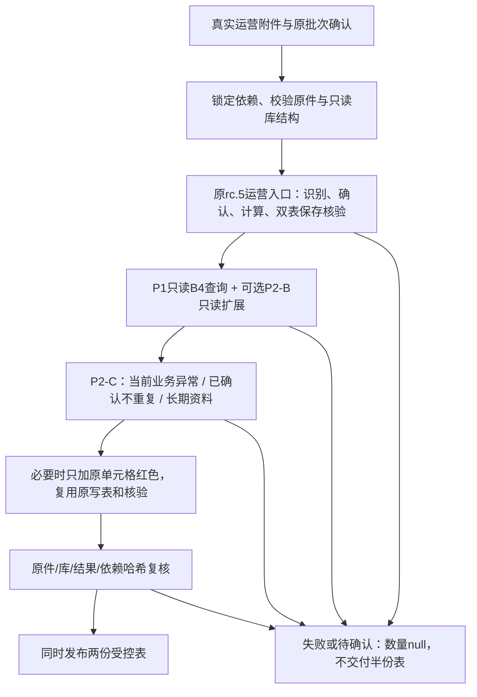

# P3-A 商品资料库与运营主流程隔离集成候选

基于rc.5 `4773446`（运行时`0.8.0-rc.5`）、P1 `1ea746a`、P2-B `dfc4537`、P2-C `0d122d8`。新增候选入口，直接调用原rc.5“处理已确认运营表”分支；原引擎、映射、查询模块、分类规则和正式门禁均不修改。未合并主分支，不是WorkBuddy安装包或实机通过记录。

## 集成架构



资料库候选与计算输入之间没有回写通路。P1保留候选、被拒候选、材质原文、缺失/冲突及来源；P2-B事实和基础维护事件通过原只读接口查询。查询完成后仍不自动确认商品身份、批准材质、修改名称/数量/价格/盒规/税率或调用D1。F混合款式文本不当作稳定版本/规格查询；JAN不从编码长度猜测。

## 数据库兼容与权限边界

- 仅兼容已核对的基础schema 3、B4来源schema 1及必要查询列。使用P1 `mode=ro`、`query_only=ON`连接，不调用旧`arrival_core.product_library.ProductLibrary`，不初始化、迁移或覆盖任何库。
- 普通B4无需P2-B扩展也可运行。存在扩展时必须三个表结构完整，再调用P2-B；错误、损坏或不兼容不能降级成“无候选”。
- 使用静态、DELETE日志模式的库/快照。活动WAL/SHM/journal直接拒绝，不切换原库日志模式、不自动备份或checkpoint。
- 当前原件SHA从独立历史候选中排除。配置可显式给外部`current_batch_id`，排除已登记的本批其他版本；不从文件名猜批次。不以同批命中率冒充新批覆盖率。
- 所有候选、原行、来源、分类和正式缺项只放后台JSON。没有写库、正式输出、网站访问或自动外发入口。

## 新批次运行

在本目录用**独立Python进程**调用，不能与在用rc.7/rc.5模块空间混载。依赖沿用既有openpyxl，不下载新包。`dependency-lock.json`对原相邻模块的88个文件做哈希检查；必须保留仓库目录结构，不把候选覆盖到已有Skill路径。

```powershell
python -X utf8 -B -m integrated_arrival --request <运营请求.json> --library-config <只读资料库配置.json> --output <全新隔离运行目录>
```

运营请求与原rc.5的`workbuddy`请求相同：`message=处理已确认运营表`、`files`及可选`units_confirmation`、`comparison_files`、`no_code_reasons`、`reference_evidence`、`tax_allocations`。不接受旧库维护或正式输出命令，库配置不传入计算引擎。请求由维护/宿主程序构造，不要求运营手写JSON。

库配置示例（占位）：

```json
{"database":"<现有B4或P2-B静态资料副本.sqlite3>","current_batch_id":"<明确的本次业务批次号，可选>"}
```

第一轮没有单位确认时返回原引擎`needs_confirmation`、本批来源/换算/配对范围；异常数量为null。第二轮仍按原rc.5规则确认当前来源哈希、单位、特殊换算及必要的配对/分摊范围。原件或范围变更要重新确认，不因资料库有历史值而跳过。

只有真实输入校验、原计算、双表保存后核验、只读查询、P2-C分类和最终完整性检查全部通过，才返回数值异常数量。输入错误、缺确认依据、库不可用/不兼容、查询错误或核验失败均返回`validation_incomplete`或原`needs_input`，数量null，业务文件为空。null不等于0。

## 两份交付及分类

`delivery/`只含海关表、内部到货表，保持原字段白名单、内部F/备注/YD、行序、公式/缓存和箱重页。没有新增审核工作簿或审核附页。`technical/`含标准化输入、原计算状态、候选来源、完整分类、日志和必要的计算中间文件，不作为业务附件。

只有当前必要字段缺失、当前值缺确认依据或本批来源冲突进入业务异常。未知版本和历史资料不完整留后台；已确认当前值不因库缺失或历史冲突重复要求填写。没有匹配候选本身不阻断完整当前输入。

缺税率等原引擎允许的待算草稿仍保留原红色；真正未知材质等当前异常也只在原相关单元格标红，值和公式不改。新增颜色时用原写表函数重建同款双表并重新核验；颜色以外的数据负载必须一致。取整、分摊、原表执行价调整继续用原浅黄/橙色，不重复生成待填任务。批次金额冲突单列当前批次事项，不自动调平。

两张表通过全部检查后才同时进入`delivery/`。复制中断只留技术暂存；发布后完整性检查失败会将两份移入本次`technical/rejected-delivery/`，清空业务路径和异常计数，保留诊断。

## 验收与证据

```powershell
python -X utf8 -B -m unittest discover -s tests -v
python -X utf8 -B validate_real.py --config <私有验收配置.json>
```

测试使用临时合成数据库/附件，不修改真实库。真实验收配置含原确认请求、原来源证据、既有双表、库路径、原B4路径、明确批次号、保护哈希、新报告和运行目录；私有配置和结果不提交。

真实回放必须从运营原件重新进入整个流程，不能读取旧异常计数后直接返回0。旧确认只在原件字节、映射字节及特殊换算/配对范围完全相同时沿用；隔离checkout造成的映射路径变化单独留证，不能用此机制批准不同业务数据。

无差异比较覆盖所有单元格、公式、缓存、样式、数量金额、箱重、原行序、F、备注、YD、尺寸及受控页眉。跨运行的状态description哈希和文档创建/保存时间单独记录，不要求新包SHA与旧包相等；旧文件本身SHA前后必须不变，新交付SHA须等于已核验文件。

当前测试结果和真实逐行数据只留本地报告，不把候选精确匹配称作业务身份批准，不把受控草稿完整称作正式通过。WorkBuddy原生触发、身份与保存均未实测。

## 回滚

停止使用此候选入口，继续调用原rc.5入口和原隔离输出路径即可；原B4、P1/P2-B资料副本、D1及已有文件不需恢复。不要覆盖本次输出目录重试；失败保留`result.json`、`technical/failure.json`、`technical/engine/input-problems.json`（若有）及来源哈希，修正真正输入/环境问题后换新目录。

不使用本候选的`delivery/`作为原业务输入。被隔离的结果不外发；原正式门禁一直关闭。用户未授权后续阶段前，不安装WorkBuddy、不扩展网站或数据库写入。
